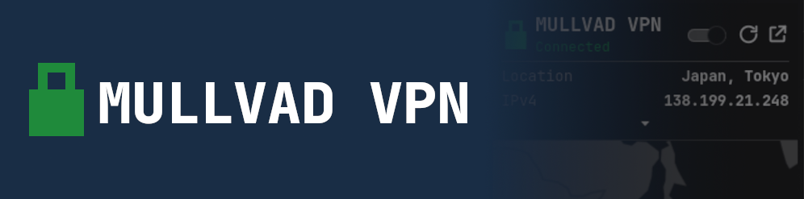
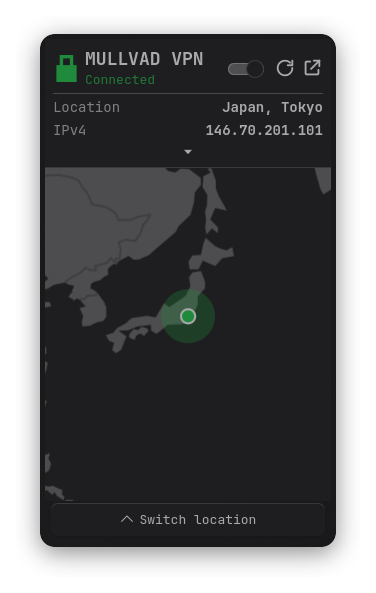
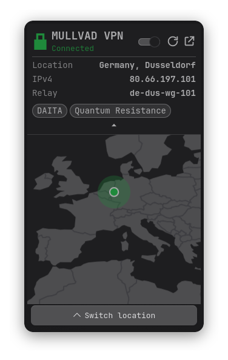
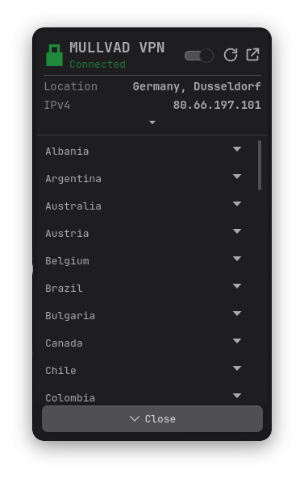
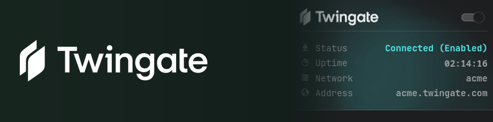
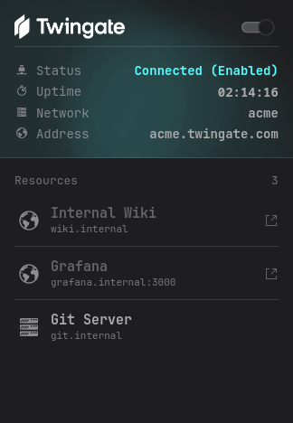
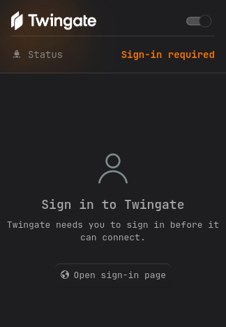
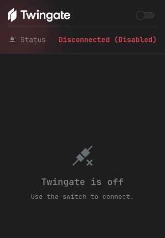

<h1 align="center">&nbsp; Plasma Widgets</h1>

<p align="center">
  Widgets for KDE Plasma, made by me ( • ⩊ • )
</p>

<p align="center">
  
  
</p>

## Widgets

Click a widget to see what it does and how it looks.

<details>
<summary><b>Mullvad VPN</b> - Plasmoid to interact with Mullvad VPN</summary>

<br>

<p align="center">
  
</p>

Control Mullvad VPN from the panel: see your connection at a glance, switch it on or off, and pick a country or city on a map.

- Tray icon that shows the state, tinted to your theme or your own colors
- Popup with connection details, a world map and a location picker
- Quick toggle by right-click, middle-click or a keyboard shortcut
- Clear messages if the `mullvad` CLI or its service is missing

[Full documentation →](org.danewrx.mullvad/README.md)

<p align="center">
  
  
  
</p>

</details>

<details>
<summary><b>Twingate</b> - Plasmoid to interact with the Twingate Linux client</summary>

<br>

<p align="center">
  
</p>

Control Twingate from the panel: see whether you are connected, switch it on or off, sign in when it asks, and open your resources.

- Panel icon with the Twingate logo, colored by state, in your theme colors or your own
- Popup with the status, uptime, network and address, and a list of your resources with their favicons and ports
- A sign-in button when Twingate needs you to sign in
- Quick toggle by left-click, middle-click or the right-click menu (asks for your password through KDE)
- Clear messages if the `twingate` CLI is missing

Unofficial: not affiliated with or endorsed by Twingate. Twingate and its logo are trademarks of Twingate Inc.

[Full documentation →](org.danewrx.twingate/README.md)

<p align="center">
  
  
  
</p>

</details>

## Install

> [!TIP]
> Installing from the KDE Store is recommended.

<details>
<summary><b>KDE Store</b></summary>

Right-click the panel → **Add Widgets…** → **Get New Widgets…** → **Download New Plasma Widgets…**, search for the widget by name and click **Install**.

Or get it from the [KDE Store listing](https://store.kde.org/p/2381258/).

</details>

<details>
<summary><b>Manual, from a release</b></summary>

Download the `.plasmoid` file for a widget from the [Releases](../../releases) page, then:

```bash
kpackagetool6 -t Plasma/Applet -i <file>.plasmoid
```

Right-click the panel → **Add Widgets**, and search for the widget by name.

</details>

<details>
<summary><b>From source</b></summary>

Clone this repo and point the command at the widget's folder:

```bash
kpackagetool6 -t Plasma/Applet -i <widget folder>
```

</details>

### Update and remove

| | Command |
|---|---|
| Update | `kpackagetool6 -t Plasma/Applet -u <file or folder>` |
| Remove | `kpackagetool6 -t Plasma/Applet -r <widget id>` (e.g. `org.danewrx.mullvad`) |

The shell caches widget code, so if a panel instance doesn't pick up an update, restart it with `systemctl --user restart plasma-plasmashell`.

## Issues and contributing

| I want to… | Go to |
|---|---|
| Report a bug | [Bug report form](../../issues/new?template=bug_report.yml) |
| Suggest a feature | [Feature request form](../../issues/new?template=feature_request.yml) |
| Ask a question or share an idea | [Discussions](../../discussions) |
| Contribute code | [CONTRIBUTING.md](CONTRIBUTING.md): commit and PR conventions, testing a widget, and how releases work |

## Support

These widgets are free and open source. If you find one useful, you can support its development:

<p>
  <a href="https://github.com/sponsors/danewrx"></a>
  <a href="https://ko-fi.com/danewrx"></a>
</p>

Starring the repo and reporting bugs help just as much!

## License

[MIT](LICENSE)
