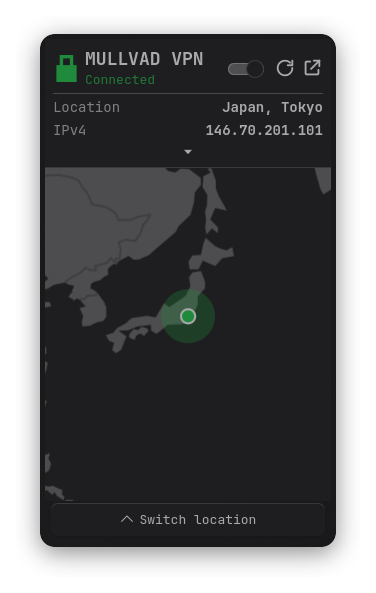
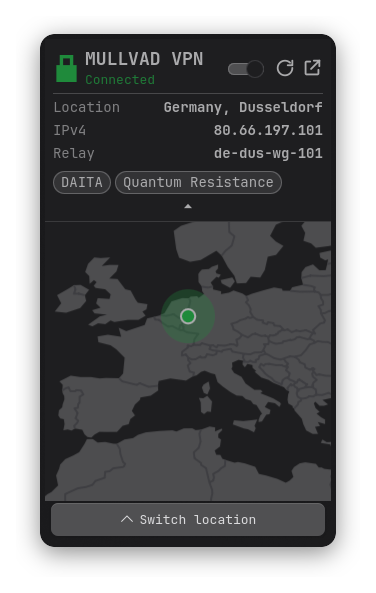
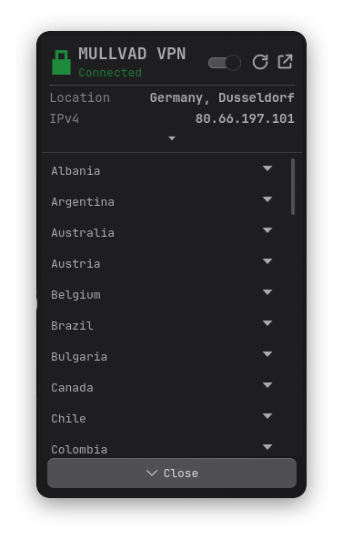
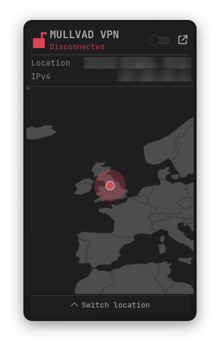
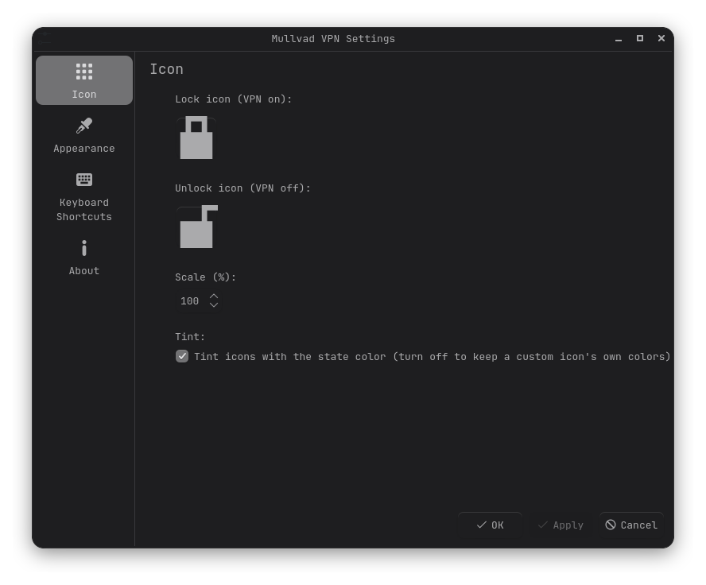
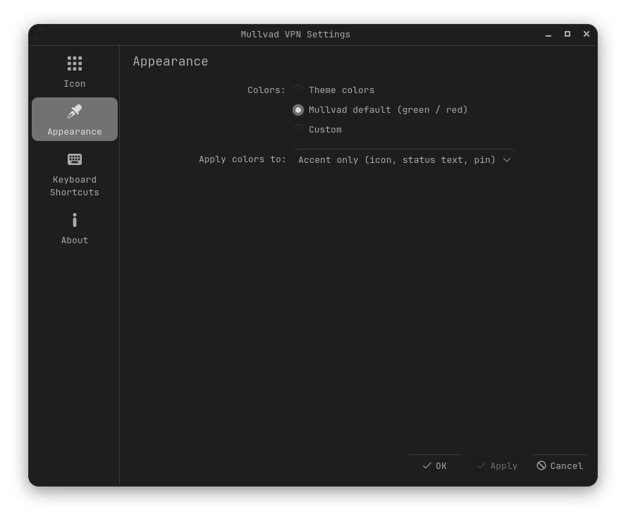

# Mullvad VPN for Plasma

A KDE Plasma 6 panel widget that shows your [Mullvad VPN](https://mullvad.net) connection and controls it through the official `mullvad` command-line tool.

> **Unofficial.** This project is not made by, affiliated with or endorsed by Mullvad VPN AB. "Mullvad" and its logo are their trademarks.

<p align="center">
  
  
  
</p>

## Features

- **Tray icon** that shows whether you're connected, with your own icons and colors if you like.
- **Popup** with a status banner, expandable connection details and a world map that follows your relay.
- **Location picker** for countries and cities.
- **Quick actions** to toggle, reconnect and open the Mullvad app without leaving the panel.
- **Theme-aware**: uses your Plasma colors by default, or Mullvad green/red, or colors you choose.
- **Helpful errors** when the CLI or its service isn't available.

## Requirements

- KDE Plasma 6 (developed and tested on 6.8)
- The Mullvad VPN app, which provides the `mullvad` CLI and the `mullvad-daemon` service (developed against mullvad-cli 2026.5)
- Linux with systemd (for the service)

The widget makes no network requests of its own. Everything goes through the `mullvad` command.

## Installation

> [!TIP]
> Installing from the KDE Store is recommended.

<details>
<summary><b>KDE Store</b></summary>

Right-click your panel → **Add Widgets…** → **Get New Widgets…** → **Download New Plasma Widgets…**, search for "Mullvad VPN" and click **Install**, then add it to the panel.
<!-- Once the product is live, add its link here: [store.kde.org listing](https://store.kde.org/p/XXXXXXX) -->

</details>

<details>
<summary><b>Manual, from a release</b></summary>

Download `org.danewrx.mullvad-<version>.plasmoid` from the [Releases](../../../releases) page, then:

```bash
kpackagetool6 -t Plasma/Applet -i org.danewrx.mullvad-<version>.plasmoid
```

Right-click your panel → **Add Widgets** → search for "Mullvad VPN".

</details>

<details>
<summary><b>From source</b></summary>

Clone the repo and run this from its root:

```bash
kpackagetool6 -t Plasma/Applet -i org.danewrx.mullvad
```

</details>

### Update and remove

```bash
kpackagetool6 -t Plasma/Applet -u <file or folder>      # update
kpackagetool6 -t Plasma/Applet -r org.danewrx.mullvad   # remove
```

After an update, restart the shell if the panel still shows the old version: `systemctl --user restart plasma-plasmashell`.

## Using it

### The panel icon

| State | Icon |
|---|---|
| Connected | closed lock |
| Connecting | closed lock, dimmed |
| Disconnected, blocked or unknown | open lock |
| Problem (CLI missing, service stopped) | dimmed |

| Action | What it does |
|---|---|
| **Left-click** | Opens the popup |
| **Middle-click** | Turns the VPN on or off |
| **Right-click** | Menu with **Connect** / **Disconnect**, and **Reconnect** while connected |
| **Hover** | Tooltip with the status, location, IP, relay and features |
| **Keyboard shortcut** | Toggles the VPN (see below) |

Toggling shows the new state straight away ("Connecting…" with a loading animation) and the widget then confirms it against Mullvad.

**Keyboard shortcut.** Right-click the widget → **Configure** → **Keyboard Shortcuts**, and assign a key to **Activate widget**. Each press toggles the VPN. It doesn't open the popup.

### The popup

**Banner.** Shows the state and these controls:

- the **switch** turns the VPN on or off
- the **reconnect** button (circular arrow, visible while connected) reconnects to a matching relay
- the **open** button launches the Mullvad desktop app (visible if it's installed)

Under the title it shows your **location** and **IP address**. The small arrow at the bottom of the banner expands it to show the **relay**, the entry relay for **multihop**, and your enabled **features** (DAITA, Quantum Resistance, Quic and so on) as pills. The details are hidden while connecting.

**Map.** A world map with country borders and a pin:

- while connected, the pin is the relay's city
- while disconnected, it's the middle of the country you're in, as reported by Mullvad (no pin if Mullvad has no servers there)
- when the location changes, the map glides and zooms to fit the country. Small countries get a closer view than large ones.

**Switch location.** The button at the bottom slides a list of countries up over the map.

- Click a **country** to connect to any relay in it.
- Use the arrow on the right of a row to expand its **cities**, and click a city to connect to it.
- The current choice is highlighted.

You can pick a country or a city, not an individual server.

<p align="center">
  
</p>

## Settings

Right-click the widget → **Configure Mullvad VPN**.

<p align="center">
  
  
</p>

### Icon

| Setting | Description |
|---|---|
| Lock icon (VPN on) / Unlock icon (VPN off) | Click the preview to choose any theme icon or an image file from KDE's icon picker. The × button restores the bundled icon. |
| Scale | Icon size, 10–200% (default 100%). |
| Tint | Colors the icons with the state color (default on). Turn it off to keep a custom icon's own colors. |

### Appearance

**Colors** applies to the tray icon, the status text and the map pin, and optionally the banner.

| Mode | Description |
|---|---|
| **Theme colors** (default) | Uses your theme's own positive and negative colors. Choose **Override** to pick any theme color for active and inactive: Text, Positive, Negative, Neutral, Highlight, Link or Disabled text. |
| **Mullvad default (green / red)** | Fixed green when active and red when inactive. |
| **Custom** | Pick your own active and inactive colors. |

**Apply colors to** chooses between **Accent only** (default: the icon, status text and pin follow the colors and the banner follows your theme) and **Whole banner** (the banner is filled with the state color, with black or white text for contrast).

## When something is wrong

If the widget can't read Mullvad's status, the popup shows a message instead of the map, the tray icon is dimmed and the tooltip explains the problem. It keeps checking, so it recovers on its own once you fix it.

| Message | Cause and fix |
|---|---|
| **Mullvad CLI not found** | The `mullvad` command isn't installed. Install the Mullvad VPN app, then press **Retry**. |
| **Mullvad service isn't running** | Start it with `sudo systemctl enable --now mullvad-daemon`. |
| **Couldn't read the Mullvad status** | Any other error. The first line of the CLI's message is shown. |

## How it works

The widget runs these `mullvad` commands and parses their output:

| Command | Used for |
|---|---|
| `mullvad status` | State, location, IP, relay, features. Polled every 5 s, every 1 s while connecting. |
| `mullvad relay list` | The country and city list, with coordinates for the map. |
| `mullvad relay get` | Highlighting your current location choice. |
| `mullvad relay set location <country> [city]` | Choosing a location (followed by `mullvad connect`). |
| `mullvad connect`, `disconnect`, `reconnect` | The toggle, switch and reconnect button. |

It also looks for `mullvad-vpn` (or `mullvad-gui`) on your `PATH` to decide whether to show the open button.

## Troubleshooting

- **The panel shows an old version after updating.** Restart the shell: `systemctl --user restart plasma-plasmashell`.
- **The popup keeps an old size.** Plasma remembers a popup's size per widget instance. Remove and re-add the widget to reset it.
- **No pin on the map while disconnected.** Mullvad reported a country it has no servers in, so there are no coordinates to place.
- **The toggle shows "Connecting…" and then falls back.** The connection failed. Check `mullvad status` in a terminal.
- **Logs.** `journalctl --user -b | grep -i mullvad` shows QML errors from the widget.

## Development

```
org.danewrx.mullvad/
├── metadata.json          Plugin metadata and version
└── contents/
    ├── ui/
    │   ├── main.qml              Tray icon, popup, map, commands
    │   ├── IconView.qml          Draws a theme icon or image file, optionally tinted
    │   ├── configIcon.qml        "Icon" settings page
    │   ├── configAppearance.qml  "Appearance" settings page
    │   └── StateColorForm.qml    Color choice shared by the settings pages
    ├── config/                   Settings schema and page list
    ├── icons/                    Lock, unlock, open and reconnect icons
    └── images/                   Map land and border outlines
```

Install a working copy, then run it in a window:

```bash
kpackagetool6 -t Plasma/Applet -u org.danewrx.mullvad
plasmoidviewer -a org.danewrx.mullvad -l topedge -f horizontal
```

To test the error states, run the viewer with `PATH=/nonexistent /usr/bin/plasmoidviewer …` (CLI missing) or with `MULLVAD_RPC_SOCKET_PATH=/nonexistent` (service not running).

See [CONTRIBUTING.md](../CONTRIBUTING.md) for the commit and PR conventions.

## Credits and licenses

- Code: [MIT](../LICENSE).
- Map outlines: [Natural Earth](https://www.naturalearthdata.com), 110m land and country boundaries, public domain.
- The Mullvad icon shown in the widget list and About page is referenced from your installed Mullvad app. It isn't bundled here.
