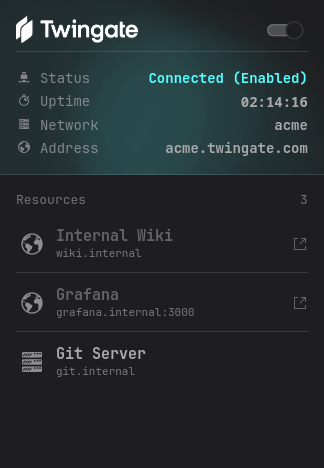
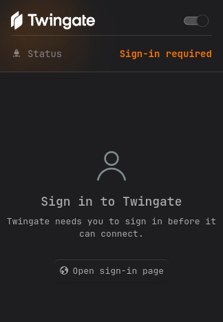
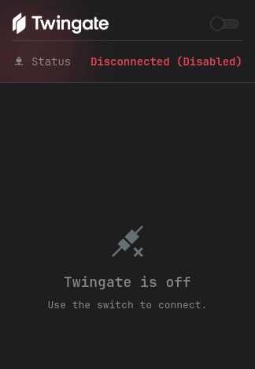

# Twingate for Plasma

A KDE Plasma 6 panel widget that shows your [Twingate](https://www.twingate.com) connection and controls it through the official Twingate Linux client, which otherwise has no graphical interface.

> **Unofficial.** This project is not made by, affiliated with or endorsed by Twingate. "Twingate" and its logo are their trademarks.

<p align="center">
  
  
  
</p>

The screenshots use sample data.

## Features

- **Panel icon** with the Twingate logo, colored by state, with your own colors if you like.
- **Popup** with the connection status, how long you've been up, your network and its address.
- **Resource list** with each resource's own favicon and port. Click one to open it in your browser.
- **Sign-in handling**: when Twingate needs you to sign in, the popup says so and has a button that opens the sign-in page.
- **Quick actions** to connect and disconnect from the switch, the right-click menu or the panel icon.
- **Configurable clicks**: choose what left-click does, and middle-click does the other thing (or nothing).
- **Theme-aware**: uses your Plasma colors by default, or green/red, or colors you choose.
- **Helpful errors** when the Twingate client isn't installed or its status can't be read.

## Requirements

- KDE Plasma 6 (developed and tested on 6.8)
- The Twingate Linux client, which provides the `twingate` command, the `twingate-notifier` command and the `twingate` systemd service (developed against 2026.302)
- Linux with systemd and polkit (`pkexec`), used to start and stop the service
- You need to have set up and signed in to your Twingate account once with `twingate setup`

The widget talks to Twingate only through its own commands, with one exception: it fetches the icon of the resources in your list (see [How it works](#how-it-works)).

## Installation

<details>
<summary><b>Manual, from a release</b></summary>

Download `org.danewrx.twingate-<version>.plasmoid` from the [Releases](../../../releases) page, then:

```bash
kpackagetool6 -t Plasma/Applet -i org.danewrx.twingate-<version>.plasmoid
```

Right-click your panel → **Add Widgets** → search for "Twingate".

</details>

<details>
<summary><b>From source</b></summary>

Clone the repo and run this from its root:

```bash
kpackagetool6 -t Plasma/Applet -i org.danewrx.twingate
```

</details>

### Update and remove

```bash
kpackagetool6 -t Plasma/Applet -u <file or folder>        # update
kpackagetool6 -t Plasma/Applet -r org.danewrx.twingate    # remove
```

After an update, restart the shell if the panel still shows the old version: `systemctl --user restart plasma-plasmashell`.

## Using it

### The panel icon

The Twingate logo, colored by state:

| State | Color (with the default theme colors) |
|---|---|
| Connected | Positive (green) |
| Disconnected or service stopped | Negative (red) |
| Sign-in required | Neutral |
| Unknown or CLI missing | Grey |

| Action | What it does |
|---|---|
| **Left-click** | Opens the popup (default, see [Settings](#settings)) |
| **Middle-click** | Connects or disconnects (default) |
| **Right-click** | Menu with **Connect** / **Disconnect** |
| **Hover** | Tooltip with the status and your network name |

Turning Twingate on or off asks for your password through a KDE dialog. See [Why it asks for a password](#why-it-asks-for-a-password).

### The popup

**Header.** The Twingate wordmark with the on/off switch, then a block of facts:

| Row | Shows |
|---|---|
| **Status** | Connected (Enabled), Disconnected, Disconnected (Disabled) or Sign-in required, in the state color |
| **Uptime** | How long the Twingate service has been running (only while connected) |
| **Network** | Your Twingate network name |
| **Address** | Your network's address, exactly as Twingate reports it |

A soft glow in the state color drifts behind the header while the popup is open.

**Resources.** Every resource Twingate gives you access to, with its name, its alias and its port (for example `grafana.internal:3000`).

- Resources that open in a browser show their own favicon and a link icon, and the name is in your theme's link color. Click one to open it in your default browser.
- Resources that don't open in a browser, such as an SSH or database host, show a generic icon and aren't clickable.
- The list scrolls when there are more resources than fit.

**Signed out or off.** When Twingate isn't connected the popup says so instead of the list. While it waits for you to sign in, a button opens Twingate's sign-in page in your browser.

## Settings

Right-click the widget → **Configure Twingate**.

### Behavior

| Setting | Description |
|---|---|
| Left-click | **Open the popup** (default) or **Connect / disconnect**. |
| Middle-click | Does the other action. Untick **Enabled** to make middle-click do nothing. |

### Appearance

**Colors** applies to the panel icon, the status text and the glow behind the popup's header.

| Mode | Description |
|---|---|
| **Theme colors** (default) | Uses your theme's own positive and negative colors. Choose **Override** to pick any theme color for connected and disconnected: Text, Positive, Negative, Neutral, Highlight, Link or Disabled text. |
| **Green / red** | Fixed green when connected and red when not. |
| **Custom** | Pick your own connected and disconnected colors. |

**Icon scale** sets the panel icon's size, 10–200% (default 100%).

## When something is wrong

The widget keeps checking, so it recovers on its own once you fix the problem.

| Message | Cause and fix |
|---|---|
| **Twingate CLI not found** (panel tooltip) / **Install the Twingate client** | The `twingate` command isn't installed. Install the Twingate Linux client. |
| **Twingate is off** | The service isn't running. Use the switch, or run `sudo systemctl start twingate`. |
| **Sign in to Twingate** | The service is running but you aren't signed in. Use **Open sign-in page**, or see `twingate auth` and `twingate setup`. |
| **Couldn't read the status** | Twingate reported a status the widget doesn't recognise. The status it printed is shown under the message. |

## How it works

The widget runs these commands and parses their output:

| Command | Used for |
|---|---|
| `twingate status -v` | State and, while waiting for sign-in, the sign-in link. Polled every 5 s, every 1 s while you switch it on or off. |
| `twingate-notifier resources` | Your network name, address and resource list, as JSON. Only while connected. |
| `systemctl show twingate -p ActiveEnterTimestamp` | When the service started, for the uptime counter. |
| `pkexec systemctl start twingate` / `stop twingate` | Turning Twingate on and off. |

**Uptime** is how long the *service* has been running. The Twingate CLI doesn't report how long you've been connected, so if the client drops and reconnects by itself, the counter keeps going.

**Favicons.** For each resource that opens in a browser, the widget makes one request to its page and reads the page's `<link rel="icon">` (or `/favicon.ico`). This happens through your Twingate connection, to resources you already have access to, while the popup is open, and results are kept until the shell restarts. A site with a self-signed certificate, a login-protected icon, or an icon only in an `apple-touch-icon` or web manifest won't load, and the generic icon stays. The widget only ever follows `http` and `https` icon links.

**Sign-in link.** The button only opens an address whose host ends in `.twingate.com`, whatever the CLI prints.

### Why it asks for a password

`twingate start` and `twingate stop` just run `sudo systemctl`, which can't ask for a password from a panel widget. The widget runs `pkexec systemctl start|stop twingate` instead, which shows a KDE password dialog. Once the service is running, nothing else needs elevated rights.

## Troubleshooting

- **The panel shows an old version after updating.** Restart the shell: `systemctl --user restart plasma-plasmashell`.
- **The popup keeps an old size.** Plasma remembers a popup's size per widget instance. Remove and re-add the widget to reset it.
- **The switch asks for a password every time.** That's `pkexec`, see [above](#why-it-asks-for-a-password).
- **A resource has no favicon.** See *Favicons* above, the site may not allow it. The generic icon is expected.
- **The About page shows an older version.** The version is set automatically when a release is published.
- **Logs.** `journalctl --user -b | grep -i twingate` shows QML errors from the widget.

## Development

```
org.danewrx.twingate/
├── metadata.json          Plugin metadata and version
└── contents/
    ├── ui/
    │   ├── main.qml              Panel icon, popup, commands
    │   ├── IconView.qml          Draws an image, optionally tinted
    │   ├── configBehavior.qml    "Behavior" settings page
    │   ├── configAppearance.qml  "Appearance" settings page
    │   └── StateColorForm.qml    Color choice for the Appearance page
    ├── config/                   Settings schema and page list
    └── icons/                    Twingate logo mark and wordmark
```

Install a working copy, then run it in its own window:

```bash
kpackagetool6 -t Plasma/Applet -u org.danewrx.twingate
plasmawindowed org.danewrx.twingate
```

To test the error states, run it with `PATH=/nonexistent /usr/bin/plasmawindowed org.danewrx.twingate` (CLI missing), or stop the service with `sudo systemctl stop twingate` (off). `sudo twingate stop --purge` clears your saved tokens, so the next start asks you to sign in again (`twingate account logout` only ends the session).

The window opens at a default size, larger than the real popup (about 324 × 468 px).

See [CONTRIBUTING.md](../CONTRIBUTING.md) for the commit and PR conventions.

## Credits and licenses

- Code: [MIT](../LICENSE).
- The Twingate logo and wordmark in `contents/icons/` belong to Twingate and are **not** covered by the MIT license. They are used here only to show which product the widget controls.
- Other icons (the link, stopwatch, globe and so on) come from your installed icon theme and aren't bundled.
